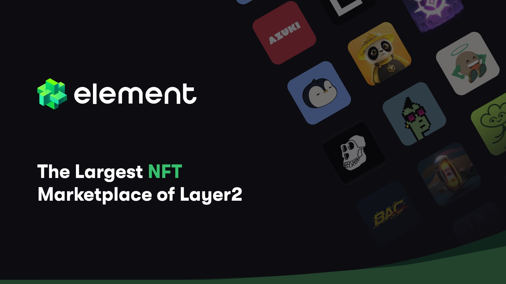

<div align="center">



# element-market-skill

List, buy and price NFTs on Element Market (BNB Chain) from an AI agent.
No paid API key. All signing goes through the Binance Agentic Wallet.


</div>

---

## Install

```bash
npx github:mosfick21/element-market-skill
```

Or manually:

```bash
git clone https://github.com/mosfick21/element-market-skill
cd element-market-skill
pip install eth-account eth-abi eth-utils
```

Add your agent wallet:

```bash
mkdir -p ~/.config/element-market
echo '{"main": "0xYourAgentWallet"}' > ~/.config/element-market/wallets.json
```

## Commands

| Command | Action |
|---|---|
| `floor <slug> [n]` | Cheapest listings |
| `item <nft> <id>` | Asset, best ask / bid |
| `mine <wallet>` | Your active listings |
| `list <wallet> <nft> <id> <bnb> [--send]` | List an NFT |
| `buy <wallet> <orderId> [--send]` | Buy a listing |
| `cancel <wallet> <nonce> [--send]` | Cancel a listing |

```bash
python3 scripts/em.py list main 0xNFT 3079 0.0004 --send
```

Without `--send`, nothing is signed or sent.

## Output

```json
{
  "priceBNB": 0.00038,
  "youGetBNB": 0.0003534,
  "approved": true,
  "ok": true,
  "orderId": "4057243579547595328"
}
```

## Config

| Env | Default |
|---|---|
| `EM_WALLETS` | `~/.config/element-market/wallets.json` |
| `EM_BAW_DIR` | `~/.baw-{name}` |
| `EM_BAW_BIN` | `baw` |
| `BSC_RPC` | Public BNB Chain RPC |

## Notes

- Listing is gasless. Only the first approval per collection costs gas.
- No private keys anywhere. `wallets.json` holds addresses only.
- BNB-priced ERC-721 is supported.

---

<div align="right"><sub><b>DYOR.</b> Unofficial. Not affiliated with Element or Binance.</sub></div>
